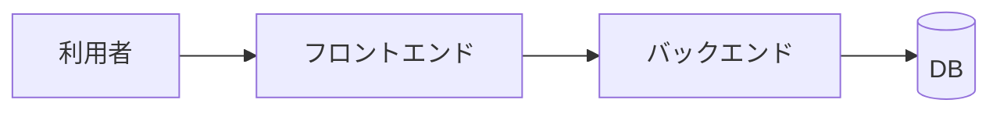

<!-- 02-design: どう作るか。実装の中身(03)は書かない。
     すべての設計判断に理由と却下案を書く(理由の無い設計判断は誰も変えられない負債になる)。
     記述ルール: .claude/directions/02-design.md -->

# システムアーキテクチャ

## 全体構成

## コンポーネントの責務

| コンポーネント | 責務 | 対応要件 |
|---|---|---|
| <> | <> | <> |

## データの流れ

<主要な流れを1つずつ。どこで永続化され、どこで外部に出るか>

## 外部システムとの境界

<!-- ID は 01-requirements/system.md の外部依存表と**同一**(`EXTERNAL-<system>`。台帳は 01 側) -->

| ID | 外部システム | 何を渡すか | 何を受け取るか | 失敗時の方針 |
|---|---|---|---|---|
| EXTERNAL-<system> | <> | <> | <> | <> |

## 契約の版と互換性の方針

<!-- **docs/02-design/contracts/ のすべての契約に掛かる共通方針。ここが唯一の持ち主である**
     (.claude/directions/02-design.md「architecture.md」)。
     各契約(02-contract.md / 02-contract-nonrest.md)はこの節を参照し、
     **その契約だけの例外**を書く。ここへ書いた値を契約へ写さない(conventions.md §4.2)。
     契約が1本も無いなら、この表の代わりに「適用外(契約なし)」と1行書く(**見出しは消さない**) -->

| 項目 | 方針 |
|---|---|
| 互換を壊さない変更 | <呼ぶ側を直さずに済む変更は何か。足す・緩めるのどこまでか> |
| 互換を壊す変更のやり方 | <版を分ける / 両対応の期間を置く / 一斉に切り替える — どれを既定にするか> |
| 旧版を残す期間 | <期間と、いつから数えるか> |
| 呼ぶ側への知らせ方 | <いつ・どこで知らせるか> |

## インフラ構成の設計

<!-- 環境ごとの具体的な構成値は docs/03-impl/infra/ が正。ここは設計方針 -->

| 環境 | 用途 | 構成の方針 | 他環境との差異 |
|---|---|---|---|
| local | <> | <> | - |
| dev | <> | <> | <> |
| prod | <> | <> | <> |

## 設計判断

<!-- **この節は空にできない**(検査 CS19)。判断が無かったなら「判断なし: <理由>」と書く。
     この節を触るときは既存の判断を必ず読み直し、各行を 継続/更新/削除 する -->

### DSN-arch-01 <判断のタイトル>

- 判断: <>
- 理由: <>
- 却下した案: <案と却下理由>
- 影響する要件: <>

## 未解決事項

<!-- 通常は空(「なし」)。未決点は構築記録(docs/build-records/)に置く(CLAUDE.md 原則7)。
     この節は逆生成(/retrofit)が「仕様か不具合か分類できない挙動」を置く場所で、
     空でない間はこの仕様ドキュメントの検証が通らない(/verify-docs の検査 C — 非空の未解決事項は検証を止める)。 -->

- なし
