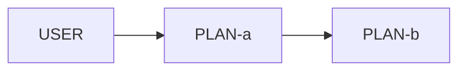

<!-- ★ 03-impl/relations/ と対になる「設計が期待する連携」。
     語彙は .claude/directions/relations.md と完全に共通(kind / sync / callers / callees / contracts)。
     PLAN-<feature-slug> の slug は実装側の MODULE-<feature-slug> と一致させる。
     02 と 03 の差分が、取りこぼし・考慮漏れの検出手段(/verify-impl の check E)。

     網羅する対象:
       ・要件に係る入口となる機能(ユーザ操作・イベント・API・スケジュール起動)
       ・モジュール境界をまたぐ呼び出し
     内部の private helper は書かない(03 側の粒度と揃える)。 -->

# 想定機能連携一覧

## 一覧

| PLAN-ID | モジュール | kind | sync | 呼び出し元 | 呼び出す先 | 契約 | 対応要件 | 概要 |
|---|---|---|---|---|---|---|---|---|
| PLAN-<slug>-<feature> | MOD-<slug> | rest-api | sync | USER-enduser, PLAN-front-x | PLAN-y, EXTERNAL-z | CTR-<name> | FR-<domain>-01 | <1行> |

<!-- kind: user-action / event / function-call / rest-api / tool / other
     外部の表現: USER-<actor> / EVENT-<name> / SCHEDULER-<name> / EXTERNAL-<system> -->

## 連携図

## 連携の詳細(設計上の期待)

<!-- この節は任意。正は上の連携一覧表(/verify-impl の check E が照合するのは表の行のみで、詳細ブロックは検査対象外)。 -->

### PLAN-<slug>-<feature>

- 目的: <なぜこの連携が必要か>
- 契機と前提条件: <>
- 呼び出す先ごとの期待: <何のために呼び、何を渡し、何を受け取り、失敗したらどうするか>
- 順序性・冪等性・並行性: <振る舞いが依存する場合のみ。依存しないなら「依存しない」と書く>
- 対応する設計判断: DSN-<area>-01

## 未実装として認識しているもの

| PLAN-ID | 状態 | 理由・追跡先(docs/issues/NNN かタスク) |
|---|---|---|
| <> | 未実装 | <docs/issues/NNN-... で管理> |

<!-- 実装が存在しない PLAN は必ずここに書く。書かないと「実装漏れ」と区別できない -->
