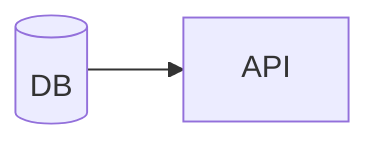

<!-- 開発環境を「どう制御するか」= 仕組み。具体的な構成値は docs/03-impl/infra/ が正。
     実在するファイルを path:line で引用する。 -->

# <トピック> の実装仕様

## 何をどう制御しているか

<実際の仕組み。誰が何を起動し、何に依存しているか>

## 関係するファイル

| ファイル | 役割 |
|---|---|
| `compose.yaml` | <> |
| `Makefile` | <> |

## 使い方(実際のコマンド)

| やりたいこと | コマンド | 備考 |
|---|---|---|
| <> | `<>` | <> |

## 依存サービスと起動順

| サービス | 起動条件 | ヘルスチェック |
|---|---|---|
| <> | <> | <> |

## 環境変数

| 変数 | 用途 | 既定値 | 必須 | 定義箇所 |
|---|---|---|---|---|
| `<>` | <> | <> | <> | `<path>:<line>` |

<!-- 値が秘密のものは「秘密(置き場所のみ記載)」とし、値そのものを書かない -->

## 落とし穴

| 事象 | 原因 | 回避方法 |
|---|---|---|
| <> | <> | <> |
