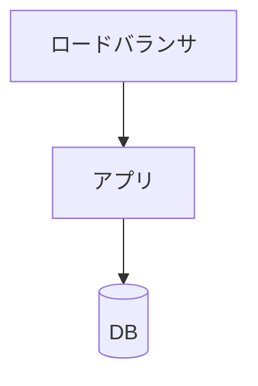

<!-- 環境ごとの具体的な構成。docs/03-impl/infra/{local,dev,prod}/ に置く。
     IaC がある場合はその定義ファイルへの path 参照を必ず入れる(IaC が正、ここは索引)。
     シークレットは「置き場所」だけ書き、値は絶対に書かない。 -->

# <環境名> のインフラ構成

## 構成図

## リソース一覧

| リソース | 種別・サイズ | 用途 | 定義箇所 |
|---|---|---|---|
| <> | <> | <> | `infra/<env>/main.tf:12` |

## ネットワーク

| 項目 | 値 |
|---|---|
| <VPC / サブネット / 公開範囲> | <> |

## 権限・ロール

| 主体 | 権限 | 付与理由 |
|---|---|---|
| <> | <> | <> |

## シークレットの置き場所

| シークレット | 保管場所 | 参照方法 |
|---|---|---|
| <> | <> | <> |

<!-- 値そのものは書かない -->

## 環境変数

| 変数 | 値の出どころ | 既定値 | 必須 |
|---|---|---|---|
| `<>` | <> | <> | <> |

## デプロイ手順

1. <>

| やりたいこと | コマンド |
|---|---|
| デプロイ | `<>` |
| ロールバック | `<>` |

## 障害対応(ランブック)

<!-- **期待(何を検知しどう対応するか)は 02-design/logging.md、実際の手順はここ**が置き場。
     手順は「現在の操作事実」なので SSOT に置ける(「いつやるか」等の計画は書かない)。
     運用手順が存在しない環境(ライブラリ・local など)は表を埋めず「適用外(理由)」と1行書く -->

| 事象(アラート・症状) | 一次対応 | 復旧手順 | エスカレーション先 |
|---|---|---|---|
| <> | <> | <> | <> |

## バックアップ・リストア

<!-- 適用外なら「適用外(理由)」と1行書く(空欄のままにしない — 「見ていない」と
     「見た上で不要と決めた」を同じ見た目にしない) -->

| 対象 | 取得方法・頻度 | 保持期間 | リストア手順(実測済みか) |
|---|---|---|---|
| <> | <> | <> | <> |

## 他環境との差異

| 項目 | この環境 | 他環境 | 差異の理由 |
|---|---|---|---|
| <> | <> | <> | <> |

## 既知の制限・運用上の注意

| 事項 | 影響 | 関連する課題票 |
|---|---|---|
| <> | <> | <> |
